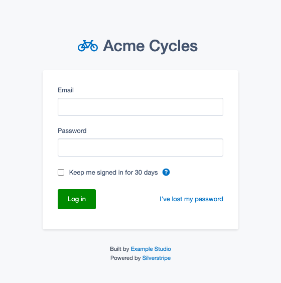
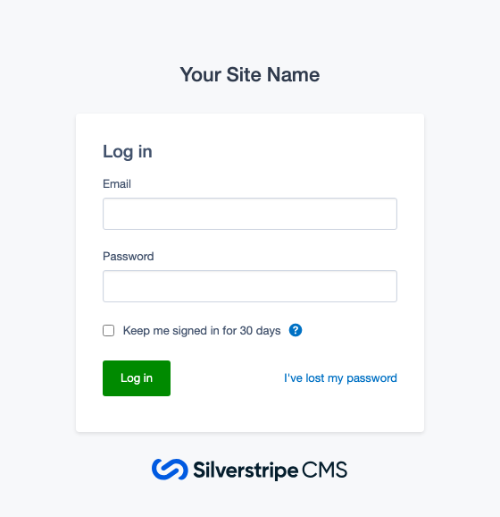
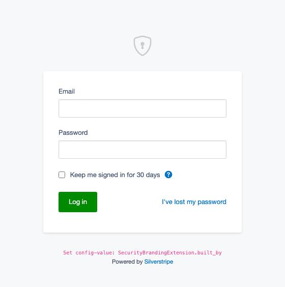
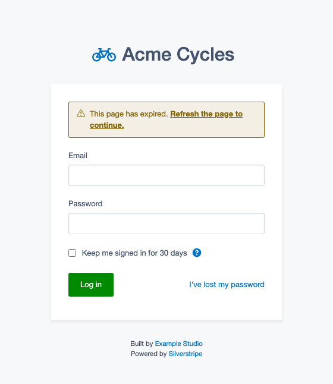

# Login branding for Silverstripe

Put your own icon, name and credits on the Silverstripe login and lost-password pages instead of
Silverstripe's, warn users before an expired login page throws away what they typed, and
optionally make your application name the site name in the CMS. For Silverstripe 5 and 6, on top
of [silverstripe/login-forms](https://github.com/silverstripe/silverstripe-login-forms).



*Maintained by [Restruct](https://github.com/restruct). If this module saves you time, you can
[support ongoing maintenance](https://github.com/sponsors/restruct).*

## Out of the box, the login page is Silverstripe's

The login forms module gives the Security pages a clean layout, but the branding on them is
Silverstripe's: a Silverstripe CMS logo under the form, the editable `SiteConfig.Title` (or
"SilverStripe" when it is empty) as the heading, and no place for your own logo or credits short of
overriding its templates in a theme.



Two more things get in the way of a white-label admin:

- **A login page left open goes stale.** Its security token (`SecurityID`) is only valid as long as
  the session lives. Submit it after that and the form answers "Your session has expired. Please
  re-submit the form.", and the credentials have to be typed again.
- **`LeftAndMain.application_name` is not the CMS site name.** With `silverstripe/siteconfig`
  installed, the CMS menu shows `SiteConfig.Title`, which any admin can edit under Settings, and
  ignores the application name you configured.

## Your brand on the login pages

### What you get without configuring anything

The branding applies as soon as the module is installed. It puts its own `login-forms` theme
first, which replaces the header above the form and the logo below it:

- above the form, a shield-lock icon linked to the site root, instead of the site title heading;
- login-forms' "Log in" header inside the form is hidden;
- below the form, two credit lines instead of the Silverstripe CMS logo: a hint telling the
  developer to set `built_by`, and "Powered by Silverstripe".



It applies to every Security page login-forms themes, such as the lost password page.

### Your own icon, name and credits

**Place a `LoginIcon.ss` template** in your project's `templates/` (or `templates/Includes/`)
directory. It replaces the shield-lock icon; an inline SVG or an `` both work, and the module
shows it 40px high. A template in a theme's `templates/` directory is only found when that theme is
in login-forms' `login_themes` (see the legacy section below for how to add it).

```html
<%-- app/templates/LoginIcon.ss - Bootstrap Icons "bicycle" --%>
<svg width="16" height="16" fill="var(--color-link-primary)" class="bi bi-bicycle" viewBox="0 0 16 16">
    <path d="M4 4.5a.5.5 0 0 1 .5-.5H6a.5.5 0 0 1 0 1v.5h4.14l.386-1.158A.5.5 0 0 1 11 4h1a.5.5 0 0 1 0 
    1h-.64l-.311.935.807 1.29a3 3 0 1 1-.848.53l-.508-.812-2.076 3.322A.5.5 0 0 1 8 10.5H5.959a3 3 0 1 
    1-1.815-3.274L5 5.856V5h-.5a.5.5 0 0 1-.5-.5m1.5 2.443-.508.814c.5.444.85 1.054.967 1.743h1.139zM8 
    9.057 9.598 6.5H6.402zM4.937 9.5a2 2 0 0 0-.487-.877l-.548.877zM3.603 8.092A2 2 0 1 0 4.937 
    10.5H3a.5.5 0 0 1-.424-.765zm7.947.53a2 2 0 1 0 .848-.53l1.026 1.643a.5.5 0 1 1-.848.53z"/>
</svg>
<%-- Optionally add some inline <style> while at it --%>
```

**And configure** the name next to it and the credits below the form:

```yml
# app/_config/login-branding.yml
Restruct\SilverStripe\AdminBranding\SecurityBrandingExtension:
  app_brand: 'Acme Cycles' # leave unset to show just the icon (eg a company logo)
  built_by: 'Built by <a href="https://example.org" target="_blank">Example Studio</a>'
```

That is the configuration the screenshot at the top of this page was taken with. All options:

```yml
Restruct\SilverStripe\AdminBranding\SecurityBrandingExtension:
  include_icon: true # default: true
  app_brand: 'Acme Cycles' # default: null (= just an icon/logo)
  built_by: 'Built by <a href="...">Example Studio</a>' # default: unconfigured-warning
  powered_by: 'Powered by <a href="https://silverstripe.org" target="_blank">Silverstripe</a>' # = default
```

| Option | Default | Effect |
|--------|---------|--------|
| `include_icon` | `true` | Show the icon (a project `LoginIcon.ss`, or the built-in shield-lock) above the form; `false` removes it |
| `app_brand` | `null` | Text shown next to the icon; unset shows the icon only |
| `built_by` | a `<code>` hint telling you to set it | HTML credit line below the form; set to `null` (or `''`) to hide it |
| `powered_by` | `Powered by <a href="https://silverstripe.org" target="_blank">Silverstripe</a>` | HTML second credit line; set to `null` (or `''`) to hide it |
| `use_app_brand_template` | `false` | Render a project `AppBrand.ss` instead of icon + `app_brand` (legacy, see below) |

`app_brand`, `built_by` and `powered_by` are output as HTML, unescaped: put only trusted,
developer-written markup in them.

Shield-lock and bicycle icons kindly provided by [Bootstrap Icons](https://icons.getbootstrap.com/).

### Legacy: replace the whole header with an `AppBrand.ss` template

Configure the extension to render an `AppBrand.ss` template instead of the icon and `app_brand`
(both are then ignored; the template supplies its own):

```yml
Restruct\SilverStripe\AdminBranding\SecurityBrandingExtension:
  use_app_brand_template: true
```

Add an `AppBrand.ss` template, eg in `app/templates/[Includes/]` or
`themes/[client-theme]/templates/[Includes/]`:

```html
<a class="login-icon" href="$AbsoluteBaseURL">
    <svg xmlns="http://www.w3.org/2000/svg" width="16" height="16" fill="currentColor" class="bi bi-shield-lock" viewBox="0 0 16 16">
        <path d="M5.338 1.59a61.44 61.44 0 0 0-2.837.856.481.481 0 0 0-.328.39c-.554 4.157.726 7.19 2.253 9.188a10.725 10.725 0 0 0 2.287 2.233c.346.244.652.42.893.533.12.057.218.095.293.118a.55.55 0 0 0 .101.025.615.615 0 0 0 .1-.025c.076-.023.174-.061.294-.118.24-.113.547-.29.893-.533a10.726 10.726 0 0 0 2.287-2.233c1.527-1.997 2.807-5.031 2.253-9.188a.48.48 0 0 0-.328-.39c-.651-.213-1.75-.56-2.837-.855C9.552 1.29 8.531 1.067 8 1.067c-.53 0-1.552.223-2.662.524zM5.072.56C6.157.265 7.31 0 8 0s1.843.265 2.928.56c1.11.3 2.229.655 2.887.87a1.54 1.54 0 0 1 1.044 1.262c.596 4.477-.787 7.795-2.465 9.99a11.775 11.775 0 0 1-2.517 2.453 7.159 7.159 0 0 1-1.048.625c-.28.132-.581.24-.829.24s-.548-.108-.829-.24a7.158 7.158 0 0 1-1.048-.625 11.777 11.777 0 0 1-2.517-2.453C1.928 10.487.545 7.169 1.141 2.692A1.54 1.54 0 0 1 2.185 1.43 62.456 62.456 0 0 1 5.072.56z"/>
        <path d="M9.5 6.5a1.5 1.5 0 0 1-1 1.415l.385 1.99a.5.5 0 0 1-.491.595h-.788a.5.5 0 0 1-.49-.595l.384-1.99a1.5 1.5 0 1 1 2-1.415z"/>
    </svg>
    <h1 class="app-brand__logo">AppBrand</h1>
</a>
```

For a template in a theme, put that theme first in `SilverStripe\LoginForms\EnablerExtension`'s
`login_themes` (in a config fragment that loads before `#admin-branding`):

```yml
---
Before:
  - '#admin-branding'
---
SilverStripe\LoginForms\EnablerExtension:
  login_themes:
    - 'client-theme'
```

## A notice before an expired login page rejects the form

A login page left open longer than the session lives carries a security token (`SecurityID`) that
the session no longer knows. Submitting it fails with "Your session has expired. Please re-submit
the form." and the credentials have to be typed again. The module warns before that happens: once
the page's token no longer matches the session, a notice appears above the form:



The second sentence is a link that reloads the page.

The page asks the server when the tab becomes visible, regains focus, or is restored from the
browser's back/forward cache (the `pageshow` event): the moments a stale page is about to be used.
It does not count down to an expiry time, because there usually is none to count to: with the
default `Session.timeout` of 0 the session ends whenever PHP's session garbage collection removes
it. Once the notice is shown, checking stops. Network errors are ignored; the next check simply
tries again.

It applies to every Security page with a form carrying a `SecurityID`, such as the login and lost
password forms. The MFA steps (`silverstripe/mfa`) render no such form, so the notice never appears
there; MFA handles an expired token itself.

```yml
Restruct\SilverStripe\AdminBranding\SecurityBrandingExtension:
  expired_notice: true # default: true
  expired_notice_interval: 0 # default: 0 (seconds; 0 = no periodic check)
```

| Option | Default | Effect |
|--------|---------|--------|
| `expired_notice` | `true` | Load the notice script on Security pages. `false` also closes the check endpoint (404) |
| `expired_notice_interval` | `0` | Seconds between extra checks while the page is visible; `0` keeps only the checks on visibility, focus and back/forward navigation. Ignored while `LeftAndMain.session_keepalive_ping` is `false` |

**Each check touches the session.** The request carries the session cookie, so PHP resumes the
session, which resets its garbage-collection clock, exactly like the CMS keep-alive ping
(`Security/ping`). That is why there is no periodic check by default: polling every few minutes
would keep the session alive for as long as the tab stays open and visible, and so defeat the
site's idle timeout, also on pages such as `Security/changepassword`. The checks on visibility and
focus only happen when the user comes back to the page, which would touch the session anyway. If
you do set an interval, it is dropped while `LeftAndMain.session_keepalive_ping` is `false`: a site
that switched off the CMS keep-alive should not get a new one from here.

The check is a `POST` to `Security/checktoken` with the page's token. It answers only
`{"valid":true}` or `{"valid":false}` (with `Cache-Control: no-store`). It never creates or changes
a token, and never starts a session for a visitor who has none; for a visitor who has one, it
resumes it as described above. The texts are translatable (`en` and `nl` are included), under
`Restruct\SilverStripe\AdminBranding\SecurityBrandingExtension` `.EXPIRED_NOTICE` and
`.EXPIRED_NOTICE_REFRESH`. The notice is styled from the login-forms theme's own colour variables,
so it follows its dark mode as well.

The script and stylesheet are exposed from `client/` through `silverstripe/vendor-plugin`; after
updating, run `composer vendor-expose` if your deployment does not already do so.

## Your application name as the CMS site name

By default, the CMS menu shows `SiteConfig.Title` (editable under Settings) as the site name. If you
set `LeftAndMain.application_name` in config, the menu ignores it while SiteConfig is installed.
`$SiteConfig.Title` also appears in the login page's browser tab title and in front-end templates
that use it.

This module can make `application_name` the authoritative source, overriding `SiteConfig.Title`
in memory and optionally removing the now-redundant fields from Settings. The override applies
whenever a SiteConfig record is loaded, and is never written back: the stored title stays as it
was, also when the record is saved with `forceChange()->write()`, which marks every field as
changed. It applies to **every SiteConfig record loaded from the database**, not only the one
returned by `SiteConfig::current_site_config()`: any code that reads `SiteConfig.Title` from a
loaded record, including a `DataList` or `get_by_id()` of SiteConfig, gets `application_name` while
the override is on.

```yml
# Set the application name
SilverStripe\Admin\LeftAndMain:
  application_name: 'My App'

# Enable the override
SilverStripe\SiteConfig\SiteConfig:
  application_name_overrides_title: true
  application_name_clear_fields: 'tab'  # see options below
```

### `application_name_clear_fields` options

| Value | Behavior |
|-------|----------|
| `false` | Override title but leave Title/Tagline fields in Settings |
| `true` *(default)* | Remove Title + Tagline fields from Settings |
| `'tab'` | Remove fields + remove the empty Main tab (if other tabs remain) |

With `false`, a title typed in Settings is saved, but it is not shown while the override is on:
`$SiteConfig.Title` keeps returning `application_name`.

### `hide_cms_page_permissions` options

Removes the page-permission fields (who can view / edit / create top-level pages) from Settings,
which mean nothing on a site without pages.

| Value | Behavior |
|-------|----------|
| `'auto'` *(default)* | Remove them only when `silverstripe/cms` is not installed |
| `true` | Always remove them |
| `false` | Always leave them |

The Access tab is removed as well when nothing else is left on it.

```yml
SilverStripe\SiteConfig\SiteConfig:
  hide_cms_page_permissions: true
```

## Requirements

* Silverstripe 5 or 6, with `silverstripe/login-forms`
* PHP 8.1 or newer
* `silverstripe/siteconfig` for the SiteConfig title override (optional; the extension is only
  applied when it is installed)

## Installation

```
composer require restruct/silverstripe-login-branding
```

The branding applies to the login forms as soon as the module is installed; everything else is
optional configuration.

Upgrading from 1.x: see [UPGRADING.md](UPGRADING.md).

## Version compatibility

| Branch | Module version | Silverstripe | PHP |
|--------|----------------|--------------|-----|
| `main` | `2.x` | `^5 \|\| ^6` | `^8.1` |
| (tags only) | `0.1.2` - `1.1.x` | `^4 \|\| ^5 \|\| ^6` | not declared |
| (tags only) | `0.1.1` | `^4 \|\| ^5` | not declared |
| (tags only) | `0.1` | `^4` | not declared |

Silverstripe 4 reached end of life in April 2025 and is no longer supported or tested here. Projects
still on it can stay on the `1.x` or `0.1.x` tags, which remain available. On Silverstripe 6, use
`2.x`: on the earlier tags `application_name_overrides_title` does nothing there, and
`LoginIconTemplateAvailable()` fatals when called directly before any template has rendered (the
login page itself is not affected). Both are fixed in `2.x` (see [CHANGELOG.md](CHANGELOG.md)).

`main` is the only maintained line: it supports every Silverstripe version this module still
targets, so there is no separate maintenance branch. A version branch will be created only when a
change cannot be made compatible across the supported range.

**`composer.json` is the source of truth** for exact constraints; this table is a quick reference.

## Running the tests

The module cannot be tested on its own: it needs a host Silverstripe project (with
`silverstripe/recipe-cms` and `silverstripe/recipe-testing`). Require it there through a Composer
**path repository with `symlink: true`** (`/tests` is `export-ignore`, so a dist or mirrored install
contains no tests), add `Restruct\LoginBranding\Tests\` pointing at the module's `tests/` to the
host's `autoload-dev`, copy `phpunit.xml.dist` to the host root as `phpunit.xml`, then:

```bash
# Silverstripe 5 (PHPUnit 9) - the path must come before flush=1
vendor/bin/phpunit vendor/restruct/silverstripe-login-branding/tests flush=1

# Silverstripe 6 (PHPUnit 11) - a flush=1 argument is ignored, use the env var
SS_PHPUNIT_FLUSH=1 vendor/bin/phpunit --testsuite loginbranding
```

CI runs the same suite against Silverstripe 5 and 6 on every push; see `.github/workflows/ci.yml`.
Playwright browser tests of the login page (`tests/browser/`) run in
`.github/workflows/browser-tests.yml`. The screenshots in this README are generated by
`tests/browser/screenshots/`, never edited by hand.

## Changelog and license

See [CHANGELOG.md](CHANGELOG.md). MIT licensed, see [LICENSE](LICENSE).
